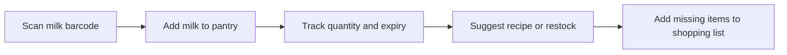
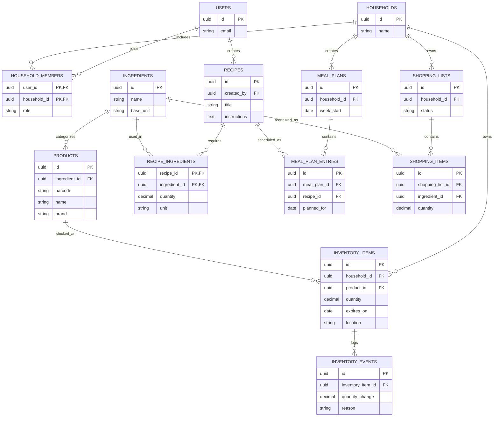
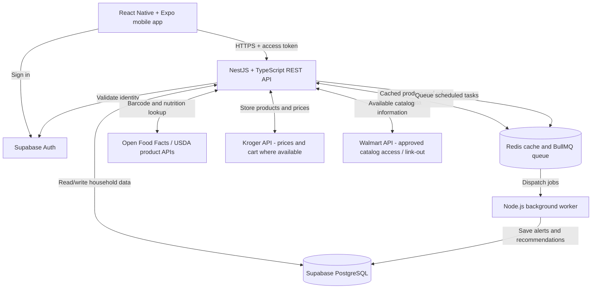

# Smart Pantry — Final Project Proposal

## Project purpose and goals

**Smart Pantry** is a mobile-first application that helps people keep track of the food they have at home, use food before it expires, plan meals, and build grocery lists.

**The idea:** Scan a food barcode → add the product to a household pantry → see what is expiring or running low → find recipes and plan meals → generate a shopping list.

### Goals

- Scan a barcode with a phone camera and identify a product, with manual entry as a fallback.
- Track quantities, storage locations, and expiration dates for food shared by a household.
- Suggest recipes using ingredients already on hand, especially those expiring soon.
- Create meal plans and generate grocery lists from missing ingredients.
- **Stretch goals:** Track consumption patterns, detect low stock automatically, compare retailer prices, and prepare a Kroger/Walmart shopping cart or checkout handoff where supported.

### Example user flow



## Initial ERD

The database will use **Supabase PostgreSQL**. `USERS` represents Supabase Auth's `auth.users` table. A household can have multiple users so roommates or families can share one pantry. An inventory item is a particular batch of a product, allowing different expiration dates.



This is an **initial sketch**, not a final schema. Retailer/store/product-price tables can be added if the stretch goals are reached.

## Rough system design



### Technology choices

| Technology | Role |
| --- | --- |
| **React Native + Expo** | Mobile interface and camera barcode scanning |
| **TypeScript + NestJS (Node.js)** | REST API and business logic |
| **Supabase Auth** | User sign-in and authentication |
| **Supabase PostgreSQL** | Households, pantry inventory, recipes, and lists |
| **Drizzle ORM** | Type-safe database queries and schema migrations |
| **Redis** | Cache repeated barcode/product and retailer-price lookups |
| **BullMQ** | Background expiration checks, low-stock checks, and notifications |
| **Open Food Facts / USDA** | Product and nutrition information |
| **Kroger / Walmart APIs** | Potential retailer price comparison and cart handoff; availability depends on API permissions |
| **GitHub + GitHub Actions** | Source control and automated checks |

**Why not Kafka initially?** Kafka would be useful for durable event streaming across multiple independent services, but it is unnecessary for this class-sized MVP. A single NestJS backend, PostgreSQL event records, and BullMQ jobs are simpler.

**Scope note:** Retailer APIs do not necessarily allow placing pickup orders. The initial project will not depend on automatic checkout; it can generate shopping lists and optionally link users to retailers.

## Initial daily goals

> **Planning assumption:** The class end date was not included in the assignment text, and the linked Canvas page requires BYU login. The schedule below is a tentative plan **November 19–December 10, 2026**. Adjust the last day to the actual course deadline.

| Date | Goal |
| --- | --- |
| Nov 19 | Finalize proposal, initial ERD, and system diagram. |
| Nov 20 | Create GitHub repo, Expo app, and NestJS backend. |
| Nov 21 | Set up Supabase project, environment variables, and authentication. |
| Nov 22 | Create database schema and initial migrations. |
| Nov 23 | Implement household creation and membership. |
| Nov 24 | Build inventory CRUD API endpoints. |
| Nov 25 | Build pantry list and add-item screens. |
| Nov 26 | Implement camera barcode scanning. |
| Nov 27 | Connect barcode lookup API and manual-entry fallback. |
| Nov 28 | Add quantity, storage location, and expiration-date editing. |
| Nov 29 | Implement inventory event history. |
| Nov 30 | Add recipe and recipe-ingredient models and endpoints. |
| Dec 1 | Build recipe creation and browsing UI. |
| Dec 2 | Implement matching recipes against pantry ingredients. |
| Dec 3 | Add meal plans and planned-meal entries. |
| Dec 4 | Generate grocery lists from missing recipe ingredients. |
| Dec 5 | Add expiration and low-stock checks (simple query or BullMQ). |
| Dec 6 | Add Redis caching if core functionality is stable. |
| Dec 7 | Test household permissions, error handling, and API edge cases. |
| Dec 8 | Improve UI, empty states, and mobile usability. |
| Dec 9 | Write README, capture screenshots, and prepare demo. |
| Dec 10 | Final testing, bug fixes, and submission. |

### MVP success criteria

A user can sign in, create a household, scan or manually enter food, track inventory and expiration dates, create a recipe, and produce a grocery list based on missing ingredients. Retailer integrations, predictive restocking, and advanced recommendations are stretch goals.

## Optional UX sketch

```text
+----------------------------------+
| Smart Pantry                     |
|----------------------------------|
| Expiring soon: Milk (2 days)     |
| Low stock: Eggs                  |
|                                  |
| [ Scan barcode ] [ Add manually ]|
|                                  |
| My Pantry                        |
|  Milk         1 carton           |
|  Eggs         2 remaining        |
|  Rice         3 cups             |
|                                  |
| [Recipes] [Meal Plan] [Shopping] |
+----------------------------------+
```

---

*This proposal is an initial design and may change as implementation progresses.*
